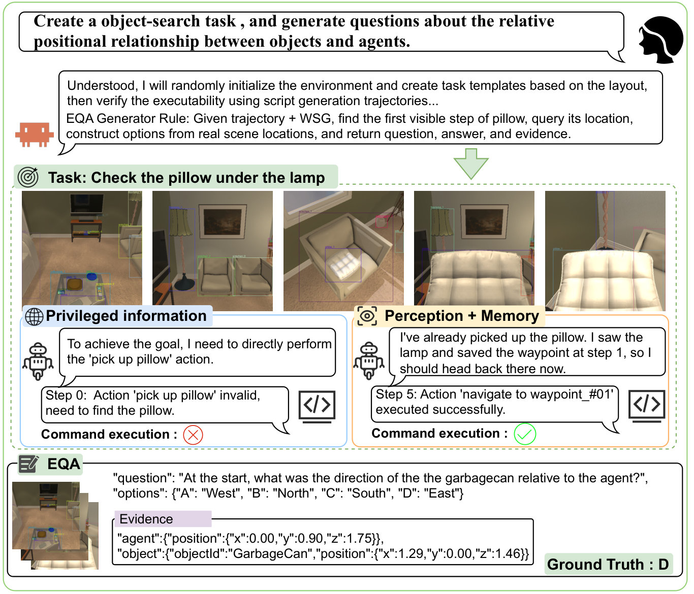
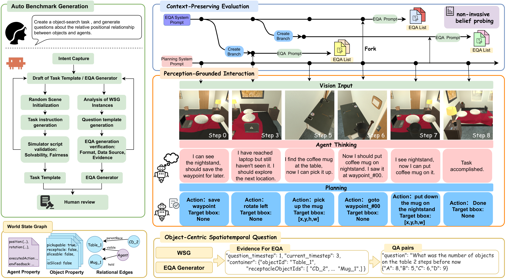
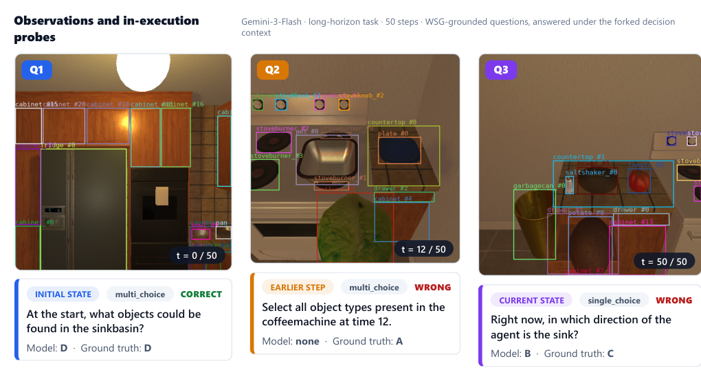

<h1 align="center">

Towards Perception-Grounded Embodied Intelligence:<br>Environment and Automated Benchmark Generation for Unified Planning and EQA
</h1>

<!-- TODO: add the 📄 Paper (arXiv) link once the preprint is published -->
<p align="center">
  📚 <a href="pgibench/envs/pgi_alfred/README.md"><strong>Environment Guide</strong></a> &nbsp;|&nbsp;
  🤖 <a href="AGENTS.md"><strong>Developer Docs</strong></a>
</p>

<p align="center">
  
  
  
  
</p>

<p align="center">
  <br>
  <em>Researchers create benchmarks through natural language. PGIEnv closes the loop with a perception-grounded interface enforcing see-then-act, and non-invasive belief probing forks the decision context to couple task execution with EQA in a unified evaluation framework.</em>
</p>

## 📌 News

- **2026.11**: Initial open-source release of **PGIEnv**, the two **benchmark-generation skills**, the evaluation harness, the **human evaluation server**, and the full **PGI Benchmark** task sets (110 tasks).
<!-- TODO: add a paper-release News entry once the paper is published -->

## 🔥 Overview

Embodied agents in unseen scenes must execute tasks and understand the scene using only **egocentric observations** — without scene-specific priors or privileged simulator information. Existing environments obstruct this setting in three ways: interfaces execute via privileged information and let agents act on objects they cannot see; evaluation decouples task execution from embodied question answering (EQA); and benchmark data relies on costly manual annotation.

**PGIEnv** addresses these gaps with one principle: **self-perception as the only information source**. The agent receives exactly four channels — the task instruction, the current egocentric RGB observation, its own pose, and the return signal of the last action. Navigation and object interaction are wrapped into perception-grounded, tool-call-style interfaces that enforce **see-then-act**. An environment-internal **world state graph (WSG)** records the full spatiotemporal state as the evidence layer for evaluation and QA generation, never exposed to the agent. **Non-invasive belief probing** forks the decision context for EQA, so decision-making and scene understanding are measured on the **same episodes**.

Built on PGIEnv, a general **benchmark generator** pairs a task-generation skill with an EQA-generator skill. Verification relies on simulator-verifiable execution and labels, followed by human quality control — yielding the **PGI Benchmark** (110 long-horizon tasks with unified execution + EQA protocol) and two additional benchmarks. We evaluate **seven vision-language models and a human baseline** under this unified protocol.

PGIEnv extends [EmbodiedBench](https://github.com/EmbodiedBench/EmbodiedBench) (EB-ALFRED) and [AI2-THOR](https://github.com/allenai/ai2thor), inheriting the Gym-style environment API, VLM planner infrastructure, and evaluation pipeline.

## ✨ Key Features

- 🙈 **See-then-act tool-call interface** — high-level semantic actions grounded in the current egocentric view; targets are resolved against per-frame instance masks (max-IoU), and attempts on unseen objects return failure feedback demanding further exploration.
- 🧭 **Action space that doesn't scale with scene size** — template commands filtered by visibility; navigate directly to objects in view and save waypoints for later return.
- 🗂️ **World State Graph (WSG)** — environment-internal temporal evidence layer supporting auditable, per-action failure attribution: perception / planning / execution failures.
- 🔬 **Non-invasive belief probing** — EQA forks the decision context without mutating it; the model answers under exactly the information state it used to decide.
- 🏭 **Benchmark generator** — two coding-agent skills ([`compose-alfred-task`](.claude/skills/compose-alfred-task/SKILL.md) and [`eqa-generator`](.claude/skills/eqa-generator/SKILL.md)) turn natural-language intent into simulator-verifiable tasks and QA; new EQA categories plug in as auto-discovered generators, no core changes needed.
- 📊 **Unified protocol & metrics** — SR / GC / SPL / GC-SPL for execution plus chance-corrected EQA-Acc / EQA-Norm for reasoning, computed on the same episodes.
- 👤 **Human evaluation server** — humans act in the same environment through the same command interface and produce results in the exact schema of automated runs, enabling direct human–model comparison.

## 📑 Contents

- [🔥 Overview](#-overview)
- [⚖️ Comparison](#-comparison)
- [🏗️ Architecture](#-architecture)
- [🏭 Benchmark Generator](#-benchmark-generator)
- [📊 PGI Benchmark](#-pgi-benchmark)
- [🏆 Results](#-results)
- [🛠️ Installation](#-installation)
- [🚀 Quick Start](#-quick-start)
- [⚙️ Configuration](#-configuration)
- [👤 Human Evaluation](#-human-evaluation)
- [📁 Output](#-output)
- [🔧 Tooling](#-tooling)
- [🤝 Acknowledgement](#-acknowledgement)
- [🖊️ Citation](#-citation)
- [📄 License](#-license)

## ⚖️ Comparison

Comparison with representative embodied environments and benchmarks:

| Environment / Benchmark | Action Abstr. | Perc. Grounding | Env Inter. | EQA Form | Auto-Gen + Verif. |
| ----------------------- | ------------- | --------------- | ---------- | -------- | ----------------- |
| AI2-THOR | Low | ✗ | ✓ | — | — |
| VirtualHome | High | ✗ | ✓ | — | △ |
| Habitat | Low | ✗ | ✗ | — | ✓ |
| iGibson | Low | ✗ | ✓ | — | ✓ |
| SimWorld | NL | ✗ | ✓ | — | △ |
| ALFRED / ReALFRED | Low | ✓ | ✓ | — | △ |
| LoTa-Bench | NL | ✗ | ✓ | — | ✗ |
| EmbodiedBench | High | ✗ | ✓ | — | ✗ |
| EmbodiedEval | High | ✗ | ✓ | Active | △ |
| ET-Plan-Bench | High | ✗ | ✓ | — | ✓ |
| IQA | Low | ✓ | ✓ | Active | ✓ |
| OpenEQA | High | ✓ | ✗ | Act.+Pass. | ✗ |
| ECBench | — | — | — | Passive | ✗ |
| FindingDory | High | ✗ | ✗ | Active | ✓ |
| **PGIEnv (Ours)** | **High, NL** | **✓** | **✓** | **Act.+Pass.** | **✓** |

> *Action Abstr.:* Low = atomic low-level; High = high-level skill; NL = natural language. *Perc. Grounding:* ✓ = egocentric perception only, no scene priors or simulator privileges. *Env Inter.:* ✓ = agent can interact with objects, changing position or state. *Auto-Gen + Verif.:* ✓ = auto-generation and auto-verification; △ = auto-generation only.

## 🏗️ Architecture

<p align="center">
  <br>
  <em>The PGIEnv environment, benchmark generation, and evaluation pipeline. The executor decomposes tool-call instructions into navigation and interaction primitives under see-then-act; the internal WSG records the full spatiotemporal state as the evidence layer; belief probing forks the decision context for EQA.</em>
</p>

PGIEnv is a unified environment for embodied agents built on EB-ALFRED and AI2-THOR, integrating three core capabilities.

### Perception-Grounded Interface

The environment enforces a **see-then-act protocol**: the agent may only interact with objects currently visible in its egocentric field, and attempts on invisible targets are judged invalid with failure feedback, requiring further exploration.

Perception alone, however, would leave the agent struggling with low-level atomic actions. PGIEnv wraps motor control into **tool-call-style semantic interfaces** that match the tool-calling conventions of modern VLMs: the agent issues a high-level command (e.g., `pick up the apple`), and the PGI executor automatically performs navigation, viewpoint adjustment, and manipulation primitives to reach a feasible interaction pose. The command's object-reference slot is resolved by the environment from the current real-time observation — the agent provides a normalized bounding box (or picks a point / id), and the environment matches it against instance-segmented candidates of the same type by maximum IoU, grounding interaction on genuine visual understanding. The agent can navigate directly to visible objects and save waypoints for later return — as if invoking a VLN model as a sub-policy.

### Trackable Structured World State Graph

The WSG is a temporal sequence of environment snapshots `G = (S₀, a₀, S₁, …, a_{T−1}, S_T)`:

- **Object nodes** — position, rotation, functional state flags (open, toggled, sliced, dirty, heated, cooled, cleaned), and containment edges to parent receptacles;
- **Agent node** — pose, inventory, facing direction;
- **Observation mask** — visible, nearby, and historically-seen object sets;
- **Transitions** — the executed action, its success, and environment feedback.

The WSG is constructed by the environment from simulator truth, kept internal, and never exposed to the agent. It makes every failed action auditable: a **perception failure** (target was not in the observation mask), a **planning failure** (target visible but the action advanced no subtask precondition), or an **execution failure** (simulator rejection or no functional-state change).

### Non-Invasive Belief Probing

At any execution step, the system **forks the decision context**: it snapshots the current dialogue state, freezes the corresponding WSG state, generates question–answer pairs from the fork, then discards the fork and resumes execution without state mutation. The forked branch replaces the planning prompt with an EQA prompt while preserving the same observation, action history, and agent state — so the model answers under **exactly the information state used for decision making**. Each episode thus yields task metrics from execution and EQA metrics from reasoning in a unified protocol.

<p align="center">
  <br>
  <em>Observations and in-execution probes: questions are grounded in the WSG and answered under the forked decision context — the model's answer is compared against the ground truth computed from environment state.</em>
</p>

## 🏭 Benchmark Generator

Manual benchmark construction is costly, noisy, and hard to verify. The PGIEnv generator lets researchers create their own tasks and EQA plugins **through natural language**, powered by two coding-agent skills that invoke environment-internal modules for scene initialization, planning, and state tracking:

| Skill | Location | Produces |
| ----- | -------- | -------- |
| Task generation | [`.claude/skills/compose-alfred-task/`](.claude/skills/compose-alfred-task/SKILL.md) | Task instructions, PDDL goal templates, expert trajectories, verified task definitions |
| EQA generator | [`.claude/skills/eqa-generator/`](.claude/skills/eqa-generator/SKILL.md) | EQA plugins (question templates, option rules, evidence extraction, verification) |

Both skills share a **four-stage pipeline**:

1. **Intent capture** — the researcher describes the desired task or question category in natural language; the coding agent parses it into a structured intent specification (scene constraints, target objects, verification criteria).
2. **Simulator snapshot** — the generator loads a scene from the scene pool, initializes object states, and captures a baseline WSG snapshot. All authoring is grounded in this real snapshot rather than templates.
3. **Grounded authoring** — the coding agent writes the task template or QA plugin against the live simulator state; every artifact references concrete object IDs and positions from the snapshot.
4. **Verification** — each artifact passes four gates: **schema completeness**, **solvability** (the expert trajectory achieves the goal from the initial state), **fair-start** (the initial state does not already satisfy the goal), and **structural validity** (no overlapping objects, reachable positions, valid containment).

Environment loading requirements are exposed as formal **contracts** (scene type, object inventory, initial states, spawn pose, visibility/reachability), so generator skills request scene configurations without hardcoding simulator internals. The generator is **not limited to the perception-grounded setting or long-horizon tasks** — the paper instantiates three benchmarks with it:

- **PGI Benchmark** — the main benchmark: sequential decision-making + spatiotemporal EQA under the zero-prior setting (below);
- **High-Level Decision Benchmark (HDB)** — imports the EB-ALFRED base subset into the PGIEnv interface for pure closed-loop planning evaluation;
- **Spatial Reasoning Benchmark (STR)** — passive EQA over full chronological image sequences, covering all 11 EQA categories.

## 📊 PGI Benchmark

The PGI Benchmark contains **110 tasks** across a 2×2 split of **task length × difficulty**:

| Eval set | Tasks | Description |
| -------- | ----- | ----------- |
| `short_simple` | 21 | Single subtask, single state change |
| `short_hard` | 18 | Single subtask, multiple preconditions |
| `long_simple` | 37 | Chained subtasks, simple goals |
| `long_hard` | 34 | Chained subtasks, multiple preconditions |

Tasks span four indoor scene types (kitchen, bathroom, bedroom, living room) and four functional families: **organizing, cleaning, slicing, heat processing**. Expert reference paths range from 4.0 steps (`short_simple`) to 41.4 steps (`long_hard`). Each episode interleaves task execution with agent-driven EQA: **15 questions** are generated and evaluated at the end of the episode (interval probing is configurable), with a step limit of 50 (short) / 100 (long).

### EQA Question Categories

The EQA taxonomy covers **11 question categories**, each instantiated over five temporal anchors (★ marks the five spatial-reasoning categories aggregated in the paper's headline EQA metrics; the full taxonomy is exercised by the STR benchmark and shipped as generator plugins in [`pgibench/envs/pgi_alfred/eqa/generators/`](pgibench/envs/pgi_alfred/eqa/generators/)):

| Category | Probes | Format |
| -------- | ------ | ------ |
| ★ `obj_loc` | Which receptacle contains a target object (e.g., *"At time {t}, in which receptacle was the {obj} located?"*) | SC |
| ★ `obj_rel_pos` | Relative position between objects (e.g., *"Currently, is the {obj1} to the east, south, west, or north of the {obj2}?"*) | SC |
| ★ `agent_vis` | What is in the agent's field of view (e.g., *"At time {t}, which of the following objects was in the agent's field of view?"*) | MC |
| ★ `obj_rel_agent` | Spatial relation of an object to the agent (e.g., *"At time {t}, was the {obj} to the east, south, west, or north of the agent?"*) | SC |
| ★ `agent_rel_objs` | Which surrounding objects relate to the agent (e.g., *"Currently, which objects are to the north of the agent?"*) | MC |
| `obj_types_in_container` | Which object types are inside a receptacle | MC |
| `obj_property` | Functional property state of an object (open, heated, cleaned, …) | SC |
| `obj_existence_seen` | Which objects have been seen so far | MC |
| `obj_count_in_container` | How many objects a receptacle contains | SC |
| `obj_count_in_scene` | How many instances of a type exist in the scene | SC |
| `obj_loc_history` | Cumulative location history of an object | MC |

**Temporal anchors** — past-anchored questions require recalling earlier observations rather than reading the present view:

| Anchor | State queried |
| ------ | ------------- |
| `current` | Snapshot S_t at the current step |
| `initial` | Snapshot S_0 at episode start |
| `n_steps_ago` | Snapshot S_{t−n} for a fixed offset n |
| `random_t` | Snapshot S_{t′} for a uniformly sampled past step t′ < t |
| `global_seen` | Union of all states observed up to t (episodic memory) |

Single-choice (SC) and multiple-choice (MC) formats use 2–8 options with distractors constructed from real scene locations and states. Full category definitions live in [`pgibench/envs/pgi_alfred/eqa/benchmark_design.yaml`](pgibench/envs/pgi_alfred/eqa/benchmark_design.yaml).

### Metrics

- **Task metrics** — Success Rate (SR), goal-condition completion (GC), and path-length-weighted efficiency **SPL / GC-SPL** following ALFRED, where longer tasks weigh more and step-limit episodes contribute zero to the numerator.
- **EQA metrics** — **EQA-Acc** (micro-averaged exact match; Jaccard similarity for multiple choice) and **EQA-Norm** (macro-averaged, chance-corrected: random guessing scores 0 in expectation, perfect answering scores 1).

## 🏆 Results

Main results on the PGI Benchmark (7 VLMs + human baseline; best per column in **bold**):

| Method | SR↑ | GC↑ | SPL↑ | GC-SPL↑ | EQA-Acc↑ | EQA-Norm↑ |
| ------ | --- | --- | ---- | ------- | -------- | --------- |
| *Human* | *98.2* | *99.5* | *65.5* | *66.3* | *59.4* | *61.2* |
| Qwen3.5-4B | 1.8 | 3.0 | 0.3 | 0.6 | 42.3 | 43.2 |
| Qwen3.6-35B | 11.0 | 15.6 | 2.6 | 4.4 | 43.4 | 45.9 |
| GPT-5.5 | 70.9 | **87.2** | 35.8 | **59.8** | 62.7 | 64.3 |
| GPT-5.4-mini | 13.6 | 24.2 | 2.0 | 6.1 | 33.4 | 35.6 |
| Gemini-3-Flash | 40.0 | 45.9 | 11.0 | 19.2 | 42.9 | 42.9 |
| Claude-Opus-4.7 | **80.0** | 86.3 | **47.9** | 53.7 | **70.8** | **74.0** |
| Claude-Sonnet-4.6 | 69.1 | 81.8 | 30.0 | 43.2 | 48.8 | 51.2 |

Three patterns stand out:

1. **Execution stratifies sharply by capability.** Frontier proprietary models reach 69.1–80.0 SR while open and mid-scale models remain at or below 13.6 SR; long tasks are substantially harder, consistent with the ten-fold spread in expert path lengths.
2. **Execution and scene understanding dissociate.** Gemini-3-Flash attains mid-tier execution (40.0 SR) but EQA-Norm close to the much weaker Qwen3.6-35B; GPT-5.4-mini scores lowest on EQA despite mid-tier GC. Claude-Opus-4.7 is the only model leading on both axes — measuring either axis alone mischaracterizes these models.
3. **EQA remains hard for everyone, including humans.** The human baseline reaches 98.2 SR but only 59.4 EQA-Acc — the questions probe genuine spatiotemporal reasoning over partial observations, not artifacts that stronger execution can bypass.

The interface itself is **load-bearing** (controlled validations, details in the paper):

- **External-grounding ablation** — removing external grounding collapses task execution (GPT-5.5: 70.9 → 16.4 SR) while EQA answerability stays near-flat (62.7 → 64.3 EQA-Acc): localization, not answerability, is the binding constraint on execution.
- **Action-space comparison (VAS vs. FAS)** — exposing the full action space instead of the visibility-constrained one makes models rely on textual priors over visual evidence, degrading planning faithfulness.

HDB and STR results produced by the same generator are reported in the paper (appendix for full STR breakdowns).

## 🛠️ Installation

### Prerequisites

- Python 3.9 (CUDA GPU build of PyTorch included in the environment file)
- Conda
- AI2-THOR runs headless via Xvfb or Xorg (no display server needed)

### Setup

```bash
git clone https://github.com/Debatrix/PGIBench.git
cd PGIBench

# Create conda environment
conda env create -f conda_envs/environment.yaml
conda activate stbench
pip install -e .

# Configure API keys (fill in the ones you use)
cp .env.template .env
```

### Download Dataset

The runtime loads ALFRED trajectories from `pgibench/envs/pgi_alfred/data/json_2.1.0/`. Clone the EB-ALFRED dataset there:

```bash
git clone https://huggingface.co/datasets/EmbodiedBench/EB-ALFRED pgibench/envs/pgi_alfred/data/json_2.1.0
```

Evaluation tasks live in `pgibench/envs/pgi_alfred/data/tasks/<eval_set>/<task_id>/task.yaml` and **ship with the repository**: the full PGI Benchmark task sets used in the paper — `short_simple` (21), `short_hard` (18), `long_simple` (37), `long_hard` (34) — plus a `smoke_test` set (one verified task) as a runnable example. Precomputed navigation layouts used at runtime ship under `pgibench/envs/pgi_alfred/gen/layouts/`.

### Start Headless Server

Required for AI2-THOR on headless servers.

**Recommended** (Xvfb — virtual display, works on all environments):

```bash
python -m pgibench.envs.pgi_alfred.scripts.start_xvfb 1
```

Alternative (Xorg):

```bash
python -m pgibench.envs.pgi_alfred.scripts.startx 1
```

The display number is selected via the `x_display` config parameter (default `'1'`).

### Verify Installation

```bash
conda activate stbench
python -m pgibench.envs.pgi_alfred.PGIAlfEnv
```

## 🚀 Quick Start

### Proprietary Models

API keys are read from a `.env` file in the project root (see `.env.template`) or from exported environment variables.

```bash
conda activate stbench
python -m pgibench.main env=pgi-alf model_name=gpt-5.4-mini exp_name='baseline'
```

### Locally Hosted Open-Source Models

Serve the model with an OpenAI-compatible server (e.g. vLLM) and point a model config at it. The bundled `qwen3.5-*` / `Qwen3.6-35B-A3B` configs expect a server on `127.0.0.1:8000/v1` with the key in `CUSTOM_API_KEY`:

```bash
# e.g. vLLM (separate tmux)
vllm serve Qwen/Qwen3.5-4B --port 8000

conda activate stbench
python -m pgibench.main env=pgi-alf model_name=qwen3.5-4b exp_name='baseline'
```

To add a model, drop a YAML into `pgibench/planner/model_configs/` (see the README there) — no code changes needed for OpenAI/Anthropic-compatible APIs.

### Smoke Test

Run the single shipped task first to verify the full stack:

```bash
python -m pgibench.main env=pgi-alf model_name=gpt-5.4-mini eval_sets="['smoke_test']" exp_name='smoke'
```

## ⚙️ Configuration

Evaluation is configured via `pgibench/configs/pgi-alf.yaml` plus Hydra CLI overrides.

### Key Parameters

| Parameter               | Default                                          | Description                                                                |
| ----------------------- | ------------------------------------------------ | -------------------------------------------------------------------------- |
| `env`                   | —                                                | `pgi-alf` (AI2-THOR)                                                       |
| `model_name`            | `Qwen3.5-35B-A3B`                                | Model config name (see `pgibench/planner/model_configs/`)                   |
| `model_type`            | `remote`                                         | `remote` (API), `custom` (locally hosted via `server_url`)                  |
| `down_sample_ratio`     | `1`                                              | Dataset fraction. Use `0.1` for debugging                                   |
| `language_only`         | `False`                                          | Text-only mode (no visual input)                                            |
| `eval_sets`             | `['short_simple','short_hard','long_simple','long_hard']` | Eval sets to run (each is a directory under `data/tasks/`)          |
| `chat_history`          | `True`                                           | Multi-turn interaction history                                              |
| `image_history_keep`    | `5`                                              | Image sliding-window size for act prompts (negative = keep all)             |
| `eqa_image_history_keep`| `5`                                              | Independent image window for EQA answering (negative = keep all)            |
| `max_steps`             | `150`                                            | Maximum steps per episode                                                   |
| `detection_box`         | `False`                                          | Draw object detection boxes                                                 |
| `resolution`            | `500`                                            | Image resolution                                                            |
| `action_display_mode`   | `command`                                        | `full` / `visible` / `command` action space display                         |
| `object_reference_mode` | `id`                                             | Command mode object reference: `id\|bbox\|point\|ordinal\|type`              |
| `instruction_mode`      | `micro`                                          | Which instruction field the planner sees: `macro` / `micro`                 |
| `x_display`             | `'1'`                                            | X display for AI2-THOR                                                      |

### EQA Parameters

| Parameter                    | Default | Description                                      |
| ---------------------------- | ------- | ------------------------------------------------ |
| `enable_eqa`                 | `True`  | Enable EQA question generation                   |
| `eqa_interval_steps`         | `-1`    | Generate questions every N steps (-1: disabled)  |
| `eqa_questions_per_interval` | `5`     | Questions per interval                           |
| `eqa_end_episode_questions`  | `-15`   | Negative N: N random questions at episode end    |

## 👤 Human Evaluation

A web server lets human evaluators act in the same environment and produce results in the exact schema of the automated pipeline (`evaluator_type: 'human'`), enabling direct comparison.

```bash
# 1. Start an Xvfb display per concurrent evaluator
python -m pgibench.envs.pgi_alfred.scripts.start_xvfb 1

# 2. Start the server (from the repo root)
python -m pgibench.human_eval.server --config pgibench/configs/human_eval.yaml
```

Then open `http://<host>:8000/` in a browser. The evaluator enters an ID, picks an eval set, and drives the agent by typing commands (with click-to-pick point / drag-to-draw bbox object references). At the end of each episode the evaluator answers the EQA questions; the episode is saved automatically.

Results are written per evaluator to:

```
running/pgi_alfred/human_eval/{eval_set}/{evaluator_id}/results/
├── episode_{N}_final_res.json     # Per-episode results (same schema as VLM runs)
├── episode_{N}_messages.json
└── thor_tracking.json             # Object state tracking data
```

Aggregate them (per evaluator, per eval set, and overall; JSON + CSV):

```bash
python scripts/summarize_human_eval.py --root running/pgi_alfred/human_eval
```

Idle sessions are reaped automatically (`session_idle_timeout` in the config); each session occupies one X display, so run one Xvfb per concurrent evaluator.

## 📁 Output

Results are saved to `running/pgi_alfred/{model_name}_{exp_name}/{eval_set}/`:

```
running/pgi_alfred/{model_name}_{exp_name}/{eval_set}/
├── results/
│   ├── episode_{N}_final_res.json     # Per-episode results
│   ├── episode_{N}_messages.json      # Conversation logs (images stripped)
│   └── thor_tracking.json             # Object state tracking data
├── logs/
└── images/
```

## 🔧 Tooling

| Script | Purpose |
| ------ | ------- |
| `pgibench/envs/pgi_alfred/scripts/check_thor.py` | Minimal AI2-THOR smoke test |
| `pgibench/envs/pgi_alfred/scripts/task_builder.py` | Preview / author new benchmark tasks (`task.yaml`) |
| `pgibench/envs/pgi_alfred/scripts/id_trajectory_generator.py` | Object-id driven trajectory generation + task feasibility verification |
| `scripts/verify_eqa_generator.py` | Exercise EQA generators on a live episode |
| `scripts/summarize_human_eval.py` | Aggregate human evaluation results (JSON + CSV) |
| `pgibench/evaluator/summarize_result.py` | Aggregate VLM evaluation results |
| `scripts/analyze_action_failures.py` | Analyze action failures from result logs |
| `scripts/results_analytics.ipynb` | Notebook for result analysis |
| `scripts/local_model_server.py` | Local inference server for custom multimodal models |
| `.claude/skills/compose-alfred-task/` | Task generation skill (natural language → verified task definitions) |
| `.claude/skills/eqa-generator/` | EQA generator skill (natural language → EQA plugins) |

Sub-module documentation for developers and AI coding agents: [AGENTS.md](AGENTS.md) and the `AGENTS.md` files in `pgibench/evaluator/`, `pgibench/envs/pgi_alfred/`, `pgibench/planner/`, `pgibench/envs/pgi_alfred/eqa/`. The environment internals (action space, coordinate conventions, EQA subsystem) are documented in [`pgibench/envs/pgi_alfred/README.md`](pgibench/envs/pgi_alfred/README.md).

## 🤝 Acknowledgement

This project is built upon [EmbodiedBench](https://github.com/EmbodiedBench/EmbodiedBench), [ALFRED](https://github.com/askforalfred/alfred), [AI2-THOR](https://github.com/allenai/ai2thor), [EmbodiedAgentInterface](https://github.com/embodied-agent-interface/embodied-agent-interface), and [Lota-Bench](https://github.com/lbaa2022/LLMTaskPlanning).

## 🖊️ Citation

If you find PGIEnv useful for your research, please consider giving this repository a star ⭐.

<!-- TODO: add the citation BibTeX once the paper is published -->

## 📄 License

This project is released under the [MIT License](LICENSE). Portions of the code derive from [ALFRED](https://github.com/askforalfred/alfred) (MIT) and other upstream projects; see the LICENSE files preserved in the respective subdirectories. The EB-ALFRED task data downloaded separately is subject to the terms of the [EmbodiedBench](https://github.com/EmbodiedBench/EmbodiedBench) release.
